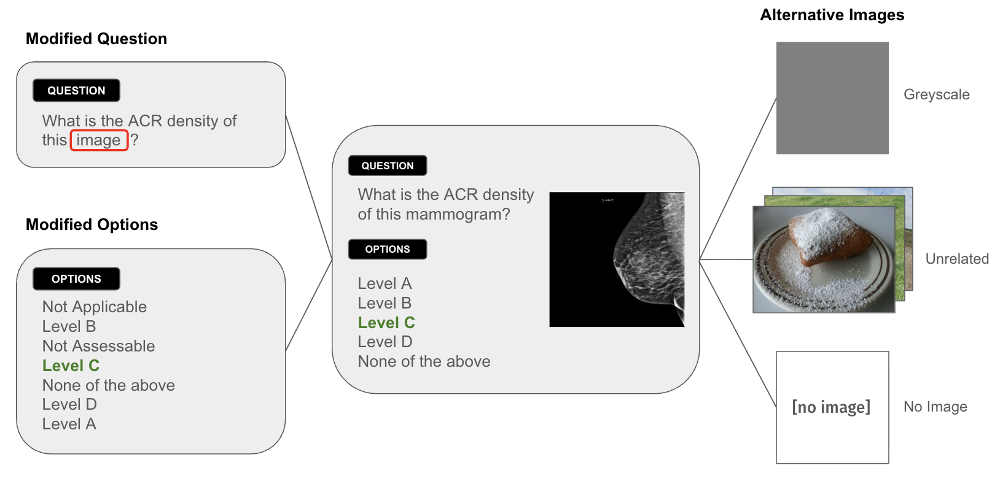

# Evaluating Coherence Among Answers, Confidence, and Reasoning in Mammography Vision-Language Models for Breast Cancer Assessment



Code for the paper *Evaluating Coherence Among Answers, Confidence, and Reasoning in Mammography
Vision-Language Models for Breast Cancer Assessment*. We ask whether a vision-language model's
**answer, confidence, and reasoning** agree with one another and with the ground truth on
multiple-choice mammography VQA, and how they hold up under controlled perturbations.

For every question, in a single generation, the model (1) states its **explicit single-best answer**,
(2) gives an independent 0–100 confidence score to each option (plus an explicit *None of the above*
option), and (3) gives a one-sentence explanation. The **explicit stated answer is the primary
signal** used throughout; because it is always well-defined, no items are dropped for score ties
(keep-ties). From these three outputs we measure where the signals diverge: the answer contradicting
its own reasoning, confidence that does not track the visual evidence, over-use of *None of the
above*, and sensitivity to meaning-preserving perturbations. Tasks: BI-RADS assessment and breast
density (ACR); the runner also supports laterality and view.

## Data

The mammograms are **not distributed here** — RSNA and EMBED are governed by data-use agreements.
You obtain four inputs and point the runner at them:

| Input | Download | Reference | Access |
|---|---|---|---|
| **RSNA images** — screening mammograms | [Link](https://www.kaggle.com/competitions/rsna-breast-cancer-detection/data) | [RSNA Screening Mammography Breast Cancer Detection AI Challenge](https://www.rsna.org/rsnai/ai-image-challenge/screening-mammography-breast-cancer-detection-ai-challenge) | Open Access |
| **EMBED images** — Emory Breast Imaging Dataset | [Link](https://registry.opendata.aws/emory-breast-imaging-dataset-embed/) | [The EMBED dataset: a racially diverse, granular dataset of 3.4 million mammographic images](https://pubs.rsna.org/doi/pdf/10.1148/ryai.220047) | Credentialed Access |
| **MammoVQA benchmark** — the questions (options, answer, topic, dataset, image path per item); image-level and exam-level | [Link](https://github.com/PiggyJerry/MammoVQA) | [A Benchmark for Breast Cancer Screening and Diagnosis in Mammogram VQA](https://doi.org/10.1038/s41467-025-66507-z) | Open Access |
| **Unrelated-image pool** — natural images for the *unrelated-photo* perturbation (ImageNet sample) | [Link](https://image-net.org) | Deng et al., 2009 | Open Access |

## Preprocessing

Convert the RSNA and EMBED DICOMs to 8-bit images with `preprocessing/prepare_images.py`, following
MammoVQA's released conversion (see paper, Appendix B). Each view is: VOI-LUT (header windowing)
applied → MONOCHROME1 inverted → rescaled to 0–255 grayscale → cropped to the breast region (largest
foreground component) → longer side downscaled to ≤1024 px → saved as JPEG (quality 90). The
grayscale→RGB channel replication is done at inference by the runner, so one grayscale file is written
per view. Name each output to match its MammoVQA path so the runner can resolve it — RSNA
`/Benchmark/RSNA/<pid>_<iid>_img/img.jpg` → `<rsna_png>/<pid>_<iid>.png`, EMBED `.../<name>.dcm` →
`<embed_png>/<name>.jpg`:

```bash
python preprocessing/prepare_images.py --dicom_dir /path/to/embed_dicoms --out_dir embed_png --format jpg
```

EMBED examinations are multi-view: each view is a separate DICOM converted independently, and the
exam-level benchmark groups the views so the runner feeds them jointly in one prompt.

Question selection needs no preprocessing: the runner samples items straight from the MammoVQA JSON,
filtered by `--datasets` and `--topics`. The ImageNet pool is used as-is (any folder of images).

## Setup

```bash
pip install -r requirements.txt
```

## Generating model outputs

Run one model over all seven conditions (real image, unrelated photo, blank image, no image, reworded
question, shuffled options, shuffled options + distractors); writes one JSON per model. Run from
inside `pipeline/`:

```bash
cd pipeline
python run_eval.py \
    --benchmark MammoVQA-Image-Bench.json \
    --rsna_png /path/to/rsna_png --embed_png /path/to/embed_png \
    --unrelated_root /path/to/imagenet_sample \
    --model_name <hf-model> --datasets RSNA,EMBED --topics birads,acr \
    --output_dir output_<model>
```

This writes `output_<model>/results.json` with, per item and condition, the **explicit stated
answer** (`explicit_answer`, the primary signal), the per-option scores and score-argmax
(`scores`/`pred_text`, secondary), the explanation, and the raw output. It resumes if interrupted.
Pass `--scores_only` for the legacy prompt that omits the explicit answer line. Model backends live
in `pipeline/vlm_inference.py`.

**Shuffle-only experiment (Figure 5).** The effect of reordering the options *alone* (no distractors)
is a separate run, `pipeline/run_shuffle_only.py`, which reuses the same prompt and queries each item
under `original` and `shuffle_only`:

```bash
cd pipeline
python run_shuffle_only.py \
    --rsna_png /path/to/rsna_png --embed_png /path/to/embed_png \
    --model_name <hf-model> --datasets RSNA,EMBED --topics birads,acr \
    --output_dir shuffle_<model>
```

The `shuffle_*` prefix keeps these results out of the main `output_*` analysis glob.

## Analysis

All analysis uses the **explicit stated answer** as the model's answer (`out_pred` in
`analysis/shared.py`), with keep-ties. Run each module from the repo root against the result JSONs
(`--help` lists subcommands and options):

| Command | What it produces |
|---|---|
| `python -m analysis.coherence gap` | answer accuracy vs reasoning accuracy, with the disconnect taxonomy |
| `python -m analysis.confidence gt` | confidence trajectories as visual evidence is removed |
| `python -m analysis.nota rate` | *None of the above* selection across conditions |
| `python -m analysis.perturbation flips` | answer-change rate under option/wording perturbations |
| `python -m analysis.mcnemar` | exact McNemar significance (SciPy) of each perturbation |

Figure 5 (reordering alone) comes from the shuffle-only run: `python -m analysis.perturbation flips
--conditions shuffle_only --glob "shuffle_*/results.json"`. Each module takes
`--glob "output_*/results.json"` (the default) and `--topics birads,acr`. `signals/` holds
the extractors they reuse: the reasoning-answer matcher (`reasoning_parser.py`), reasoning certainty
(`reasoning_confidence.py`), matcher-vs-human validation with Cohen's κ via scikit-learn
(`parser_validation.py`), and the secondary score-argmax map (`answer_mapping.py`).

## Run everything

`run_all.sh` chains preprocessing → evaluation → analysis for one model. Edit the paths at the top,
then `bash run_all.sh`.
